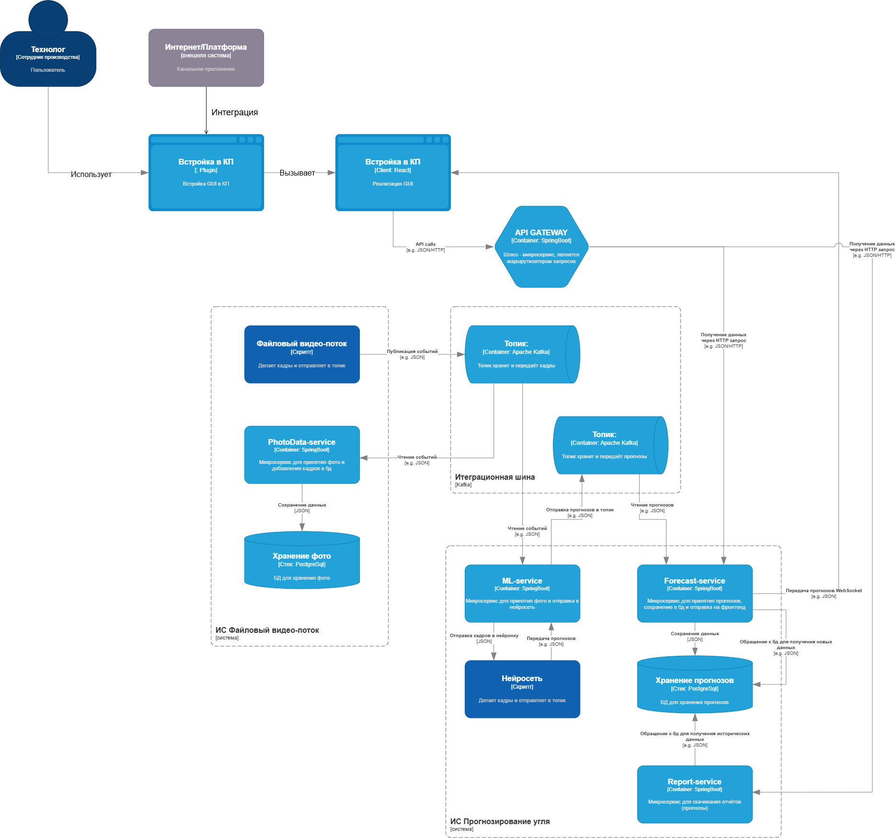

# Система прогнозирования прочностных характеристик угля

## Описание АР

Двухконтурная микросервисная система для прогнозирования прочностных характеристик угля на основе данных гранулометрии и компьютерного зрения.

**Основные возможности:**
- Загрузка данных из Excel
- Прогнозирование характеристик с помощью нейросетей (ONNX)
- Обработка видеопотока (Computer Vision)
- Реалтайм-передача результатов через WebSocket
- Генерация отчётов (Excel)
- Управление инфраструктурой через собственный контур администрирования
- Мониторинг состояния микросервисов в Kubernetes

---

## Архитектура решения

Система построена по **двухконтурной микросервисной архитектуре**:

- **Бизнес-контур** - обработка данных, прогнозирование, отчётность
- **Контур администрирования и управления** - мониторинг, управление подами, сбор метрик

Оба контура развёрнуты в **Kubernetes-кластере** и взаимодействуют через **Kafka** (интеграционная шина).

### Схема архитектуры решения

### Контуры системы

#### Бизнес-контур (NETWORK 1: BUSINESS)
Обслуживает пользователей системы:
- Авторизация и выдача JWT
- Приём Excel-данных и их публикация в Kafka
- Обработка видеопотока (Computer Vision)
- ML-прогнозирование прочностных характеристик
- Реалтайм-передача результатов через WebSocket
- Генерация отчётов (Excel/PDF)

### Зоны сети

| Зона | Назначение | Компоненты |
|------|------------|------------|
| **User zone** | Рабочее место пользователя | ВМ  |
| **Inet zone** | Точка входа из интернета | браузер, Channel app,API Gateway, Firewall |
| **Private Network** | Внутренняя сеть | Все микросервисы, БД, Kafka, K8s |

---

## Микросервисы и их интерфейсы

| Микросервис | Порт | Интерфейс | Назначение |
|-------------|------|-----------|------------|
| **Auth-Service** | 8084 | REST `/auth/login` | Аутентификация, выдача JWT |
| **API-Gateway** | 8085 | REST (проксирование) | Маршрутизация, проверка JWT |
| **Excel-Service** | 8080 | REST + Kafka producer | Парсинг Excel -> Kafka |
| **ML-Service** | 8082 | Kafka consumer/producer + ONNX | ML-прогнозирование |
| **Forecast-Service** | 8083 | REST + Kafka consumer + WebSocket | Приём прогнозов, WebSocket-рассылка |
| **Report-Service** | 8086 | REST `/reports/excel` | Генерация Excel,PDF-отчётов |
| **File-Service** | - | Kafka consumer | Обработка видеопотока |

---
