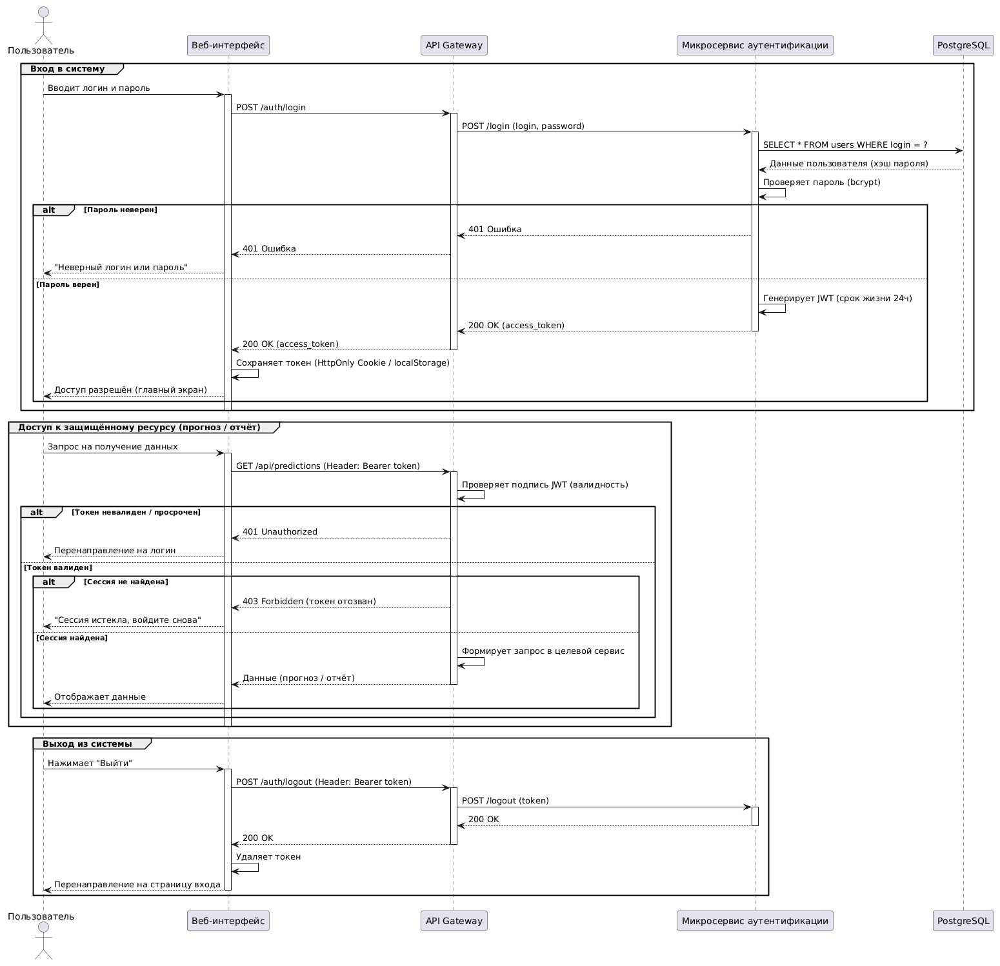
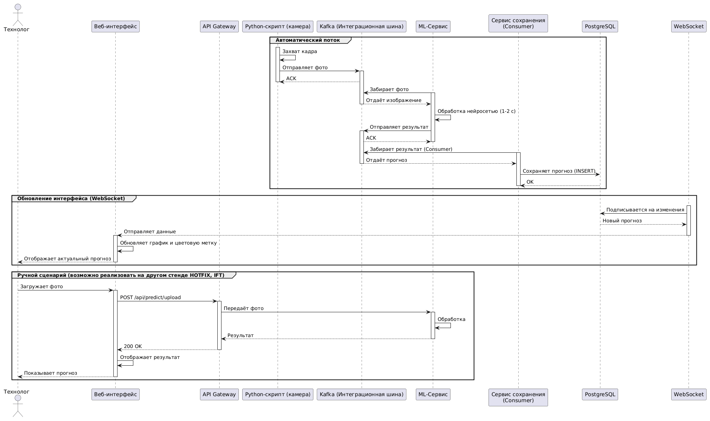

# Система прогнозирования прочностных характеристик угля

## Описание проекта

Двухконтурная микросервисная система для прогнозирования прочностных характеристик угля на основе данных гранулометрии и компьютерного зрения.

## Задачи программы

1. Автоматический сбор данных. Программа подключается к камере над конвейером и автоматически получает слепки угля. Человек не нужен.
2. Мгновенный анализ. За 1-2 секунды программа анализирует текстуру, зернистость и трещины на фото и выдает цифровую оценку прочности (в условных единицах или МПа).
3. Накопление статистики. Программа запоминает все результаты и строит графики трендов. Технолог видит динамику качества угля в реальном времени.

## Функциональные требования

### Модуль Сбор и ввод данных
1. Система должна автоматически принимать изображения кокса с промышленной камеры через Python-скрипт (без участия человека).
2. Система должна обеспечивать возможность ручной загрузки фото (для тестирования или дообучения).

### Модуль Обработка и прогнозирование (Ядро)
4. Система должна передавать полученное изображение в ML-сервис через очередь сообщений (асинхронно).
5. ML-сервис должен обработать изображение и вернуть прогноз прочности кокса (в числовом значении) за время не более 2 секунд.
6. Система должна присваивать прогнозу метку качества (Хороший, Средний, Плохой) на основе заданных порогов.

### Модуль Интерфейс пользователя
7. Веб-интерфейс должен отображать текущий прогноз, дату/время и статус обработки.
8. Пользователь должен иметь возможность просматривать историю прогнозов за выбранный период в виде списка.
9. Пользователь должен иметь возможность скачивать отчёт по прогнозам в формате PDF (с графиками и цифрами) и Excel (с табличными данными).

### Модуль Администрирование и безопасность
10. В системе должна быть аутентификация (вход по логину/паролю).
11. Должны быть реализованы как минимум 2 роли:
    - Оператор (только просмотр прогнозов и скачивание отчётов).
    - Администратор / DevOps (доступ к мониторингу и управлению системой).
12. API Gateway должен проверять JWT-токен при каждом запросе к микросервисам.

### Модуль Мониторинг и управление (DevOps)
13. Система мониторинга должна собирать метрики состояния каждого микросервиса (CPU, RAM, статус вкл/выкл).
14. Инженер должен иметь возможность через интерфейс мониторинга перезапустить упавший микросервис или посмотреть его логи (в перспективе через K8s).

## Нефункциональные требования

### Надёжность и отказоустойчивость
1. Система должна сохранять работоспособность при потере связи между микросервисами (запросы должны уходить в очередь и обрабатываться после восстановления).
2. При падении ML-сервиса система не должна терять входящие фотографии (они должны накапливаться в Kafka).
3. БД должна иметь резервное копирование (бекап) не реже 1 раза в сутки.

### Производительность
4. Время прогнозирования одного кадра (от получения фото до вывода результата в интерфейс) не должно превышать 2 секунд.
5. Система должна выдерживать нагрузку до 100 запросов в минуту без падения времени ответа.

### Безопасность
6. Вся передача данных между клиентом (браузером) и сервером должна быть зашифрована через HTTPS/TLS.
7. Хранение паролей должно осуществляться в хэшированном виде.
8. Сессия пользователя должна автоматически завершаться через заданный период бездействия (Тайм-аут).

### Масштабируемость
9. Архитектура должна позволять горизонтальное масштабирование ML-сервиса (при росте нагрузки должны автоматически создаваться новые экземпляры через Kubernetes).

### Удобство поддержки
10. Все микросервисы должны вести структурированные логи для отслеживания ошибок.
11. Внедрение новой версии ML-модели не должно требовать полной остановки системы (реализовать стенды DEV, HOTFIX, IFT, LT, PROD, PREPROD).

## User Story

### История 1. Аутентификация и вход в систему
- Роль: Оператор / Инженер
- Действие: Войти в систему, используя свой логин и пароль.
- Результат (Ценность): Чтобы получить доступ к прогнозам и отчётам, защищённым от посторонних глаз, и чтобы система запомнила мои права (роль).
- Цитата: Как оператор завода, я хочу войти в систему по паролю, чтобы видеть только те данные, которые мне разрешены, и быть уверенным, что мои действия логируются.




### История 2. Получение прогноза (Автоматический сценарий)
- Роль: Система / Автоматический скрипт
- Действие: Получить фото с камеры, отправить его в ML-сервис и выдать результат.
- Результат: Чтобы технолог мог увидеть прочность кокса за 2 минуты, не отходя от пульта, и принять решение о подаче угля.
- Цитата: Как инженер-технолог, я хочу видеть на экране цветовой индикатор (красный/зелёный) поступающего угля, чтобы мгновенно реагировать на отклонения, даже если я смотрю на печь, а не в монитор.



### История 3. Генерация и скачивание отчёта
- Роль: Инженер по качеству / Начальник смены
- Действие: Сформировать и скачать отчёт за прошедшую смену / сутки в формате PDF или Excel.
- Результат: Чтобы иметь документальное подтверждение качества сырья для отчётности перед руководством или для передачи данных в бухгалтерию (для расчёта себестоимости).
- Цитата: Как начальник смены, я хочу нажать одну кнопку Сформировать отчёт за смену и получить готовый PDF с графиками и цифрами, чтобы не собирать данные вручную из разных тетрадей.


## User Flow

### Авторизация (Путь пользователя)
1. Пользователь заходит на веб-страницу.
2. Вводит логин и пароль в поле авторизации.
3. API Gateway принимает запрос и обращается к ИС Аутентификации.
4. Если логин/пароль верны, система возвращает JWT-токен.
5. Пользователь попадает на главный экран (с графиками и формой загрузки).
6. Если не верны, система показывает ошибку и просит ввести данные заново.

### Получение прогноза (Скрипт + Пользователь)
1. Промышленная камера делает снимок.
2. Python-скрипт захватывает кадр и отправляет в Кафку (очередь 1).
3. ML-сервис забирает фото из очереди, обрабатывает и отправляет результат в Кафку (очередь 2).
4. PostgreSQL сохраняет результат.
5. Веб-интерфейс (без обновления страницы, через WebSocket) показывает технологу:
   - Зелёный фон (если кокс хороший).
   - Красный фон (если плохой) + цифровое значение прочности.

### Генерация и скачивание отчёта
1. Пользователь заходит в раздел История прогнозов.
2. Выбирает период (например: С 1 августа по 7 августа).
3. Выбирает формат: PDF (с графиками) или Excel (таблица).
4. Нажимает кнопку Скачать.
5. Сервис генерации отчётов достаёт данные из PostgreSQL, строит график (для PDF) и собирает таблицу.
6. Файл генерируется и автоматически скачивается на компьютер пользователя.

## Описание компонентов бизнес-контура

### 1. API Gateway (маршрутизация, безопасность)
- Что делает: Принимает все внешние запросы (от пользователей, скриптов, внешних систем). Проверяет JWT-токены. Направляет запросы в нужные микросервисы. Ограничивает частоту запросов (Rate Limiting).
- Как работает: Единая точка входа. Без него фронтенд и скрипты стучались бы напрямую в микросервисы, что небезопасно.
- Куда дальше: После проверки токена отправляет запрос в нужный микросервис (ML, отчёты, аутентификация).

### 2. Аутентификация и авторизация
- Что делает: Проверяет логин и пароль, выдаёт JWT-токен, управляет сессиями.
- Хранилище: Пользователи (логин, имя, фамилия, хэш пароля) в PostgreSQL. JWT-токены (срок жизни) в Redis (для быстрого доступа и отзыва).
- Как работает: При логине проверяет пароль, генерирует токен, сохраняет его в Redis. При каждом запросе API Gateway проверяет токен через Redis (если токен есть, доступ разрешён, если нет, 401).

#### Таблица users

| Поле | Тип PostgreSQL | Тип в бэкенде | Описание |
|------|----------------|---------------|----------|
| id | SERIAL (INTEGER) | int | Уникальный идентификатор пользователя |
| login | VARCHAR(50) | str | Логин (уникальный) |
| password_hash | VARCHAR(255) | str | Хэш пароля |
| first_name | VARCHAR(100) | str | Имя |
| last_name | VARCHAR(100) | str | Фамилия |


```sql
CREATE TABLE users (
    id SERIAL PRIMARY KEY,
    login VARCHAR(50) UNIQUE NOT NULL,
    password_hash VARCHAR(255) NOT NULL,
    first_name VARCHAR(100),
    last_name VARCHAR(100),
);
```

### 3. ML-сервис (ядро прогнозирования)
- Что делает: Принимает на вход фото, прогнозирует M10 и M40.
- Архитектура внутри:
  - Consumer: Читает фото из Кафки, отправляет их в модель.
  - Loader: Фоновый процесс, который запускает модель и кладёт результат в Кафку (или напрямую в БД).
  - Модель: Обучена на исторических данных, выдаёт два числа: прочность (M40) и истираемость (M10).

#### Таблица predictions

| Поле | Тип PostgreSQL | Тип в бэкенде | Описание |
|------|----------------|---------------|----------|
| id | SERIAL (INTEGER) | int | Уникальный ID прогноза |
| photo_url | TEXT | str | Ссылка на фото |
| M10 | DECIMAL(5,2) | float | Истираемость |
| M40 | DECIMAL(5,2) | float | Прочность |
| quality_label | VARCHAR(20) | str | Метка: good, medium, bad |
| user_id | INTEGER (FK) | int | ID пользователя, загрузившего фото |
| created_at | TIMESTAMP | datetime | Дата и время прогноза |

```sql
CREATE TABLE predictions (
    id SERIAL PRIMARY KEY,
    photo_url TEXT NOT NULL,
    m10 DECIMAL(5,2) NOT NULL,
    m25 DECIMAL(5,2) NOT NULL,
    quality_label VARCHAR(20),
    user_id INT REFERENCES users(id) ON DELETE SET NULL,
    created_at TIMESTAMP DEFAULT NOW()
);
```

### 4. Очереди (Kafka) зачем и как работают
- Две очереди сообщений для асинхронной передачи данных.
- Зачем: Чтобы система не падала при нагрузке. Если ML-сервис занят, фото остаются в очереди и не теряются.
- Как работают:
  - Queue 1 (raw_photos): Принимает фото от скрипта (камера), передаёт в шлюз.
  - Queue 2 (predictions_result): Принимает готовые прогнозы от ML-сервиса и передаёт их в Сервис сохранения.

### 5. Генерация отчётов (PDF, Excel)
- Формирует отчёты по прогнозам за выбранный период.
- Как работает:
  - Принимает запрос от API Gateway (период, формат).
  - Забирает данные из PostgreSQL.
  - Строит график (для PDF) и таблицу (для Excel).
  - Возвращает файл пользователю через API Gateway.
- Хранилище: Сгенерированные файлы временно сохраняются в объектном хранилище (MinIO / S3).

#### Таблица reports

| Поле | Тип PostgreSQL | Тип в бэкенде | Описание |
|------|----------------|---------------|----------|
| id | SERIAL (INTEGER) | int | Уникальный ID отчёта |
| user_id | INTEGER (FK) | int | ID пользователя, запросившего отчёт |
| file_url | TEXT | str | Ссылка на файл (PDF/Excel) |
| file_type | VARCHAR(10) | str | PDF или EXCEL |
| period_start | DATE | date | Начало периода в отчёте |
| period_end | DATE | date | Конец периода в отчёте |
| generated_at | TIMESTAMP | datetime | Дата и время генерации |

```sql
CREATE TABLE reports (
    id SERIAL PRIMARY KEY,
    user_id INT REFERENCES users(id) ON DELETE SET NULL,
    file_url TEXT NOT NULL,
    file_type VARCHAR(10) CHECK (file_type IN ('PDF', 'EXCEL')),
    period_start DATE NOT NULL,
    period_end DATE NOT NULL,
    generated_at TIMESTAMP DEFAULT NOW()
);
```

### 6. Файловый видеопоток + микросервис-получатель
- Скрипт на Python, который захватывает кадры с камеры и отправляет их в Кафку.
- Как работает:
  - Каждые N секунд делает снимок.
  - Отправляет фото в Queue 1 (raw_photos).
  - Работает независимо от остальной системы.

#### Входящие данные (от камеры)

| Поле | Тип | Описание |
|------|-----|----------|
| camera_id | string | ID камеры (если их несколько) |
| timestamp | datetime | Время захвата кадра |
| frame_data | bytes / base64 | Сырые данные кадра (JPEG/PNG) |
| frame_id | string | Уникальный идентификатор кадра |

#### Исходящие данные (в Kafka)

| Поле | Тип | Описание |
|------|-----|----------|
| camera_id | string | ID камеры (если их несколько) |
| timestamp | datetime | Время захвата кадра |
| frame_data | bytes / base64 | Сырые данные кадра (JPEG/PNG) |
| frame_id | string | Уникальный идентификатор кадра |

## Технологический стек

| Слой | Технологии |
|------|------------|
| Backend | Java 17, Spring Boot 4, Spring Cloud Gateway |
| Messaging | Apache Kafka, Zookeeper |
| ML/CV | ONNX Runtime, Python |
| Frontend | React, MUI, STOMP.js |
| БД | PostgreSQL, Redis |
| Инфраструктура | Docker, Kubernetes |


## Авторы

Студент: [Мещанинов Степан Александрович]
Руководитель: []